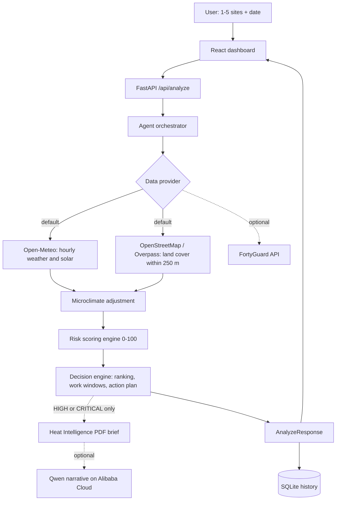

# HeatWise Agent

**Which work site is safer today, and which hours should the crew avoid?**

HeatWise is an autonomous heat-risk decision tool for outdoor teams: construction crews, delivery fleets,
utility workers and city operations. Give it one to five candidate sites and a date. It ranks the sites with a
transparent 0–100 Operational Risk Score, shows the safe and unsafe hours, writes a prioritised action plan, and
records every step it took.

Built for the FortyGuard Hackathon '26, rebuilt on free open data, and presented at the
Alibaba Cloud AI Hackathon Pakistan 2026.

## The problem

Heat exposure decisions are usually made from a city-wide forecast. But a paved bazaar and a tree-lined park a few
kilometres apart can feel very different because of pavement, buildings, shade and water. A forecast cannot tell a
supervisor which of three sites is worse, or which hours to keep the crew off the roof.

## What HeatWise does

1. Pulls hourly weather and solar data for each site.
2. Reads the land cover (buildings, roads, vegetation, water) within 250 m of each pin.
3. Adjusts the site temperature for its surroundings (see *How "hyperlocal" works*).
4. Calculates a transparent risk score, ranks the sites and lists the evidence.
5. Builds work windows (Best / Caution / Avoid / Recovery) from the real hourly forecast.
6. Writes a prioritised action plan.
7. Only for sites scored HIGH or CRITICAL, generates a PDF "Heat Intelligence brief" (optionally narrated by Qwen).

On a mild day the agent skips step 7 and says so in its decision trace; on a heatwave day it runs it.

## How "hyperlocal" works (and what it is not)

Weather models are coarse (roughly 1–11 km), so nearby sites get the same base temperature. HeatWise separates
them with a **bounded, documented microclimate adjustment** of at most ±3.5 °C, derived from the paved, vegetated
and water fractions around each site. It is a **modelled estimate, not a sensor measurement**, and every result
says so in its evidence list. Land-cover data quality varies with OpenStreetMap coverage, so each site also reports a
confidence level, and the adjustment is halved when map data is thin.

## Agent workflow

```
OBSERVE  ->  ANALYZE  ->  INVESTIGATE  ->  DECIDE  ->  ACT
```

| Stage | What happens |
|---|---|
| Observe | Hourly weather for each site and date |
| Analyze | Land cover within 250 m, heat index, wet-bulb, solar irradiance |
| Investigate | Deep report only if the computed risk is HIGH or CRITICAL (or forced by the user) |
| Decide | Rank sites by score and state which evidence drove the ranking |
| Act | Work windows and a prioritised action plan |

## Risk score

A plain weighted sum, so every number can be audited:

| Factor | Weight |
|---|---|
| Temperature | 45% |
| Heat index | 20% |
| Solar exposure | 20% |
| Paved / built-up surface | 10% |
| Lack of vegetation | 5% |

Levels: 0–24 LOW, 25–49 MODERATE, 50–74 HIGH, 75–100 CRITICAL. The weights are transparent heuristics, not a
medically calibrated model.

## Architecture



Failure ladder: fresh live data, then the last cached copy (labelled), then clearly labelled Demo Mode. Nothing is
ever silently faked: every result shows its `data_source`.

## Tech stack

- **Backend:** Python, FastAPI, Pydantic, SQLite, Shapely (geometry), ReportLab (PDF), pytest
- **Data:** Open-Meteo (weather, solar), OpenStreetMap via the Overpass API (land cover)
- **Frontend:** React, TypeScript, Vite, Tailwind CSS, Leaflet (map), Inter font
- **Optional AI:** Qwen on Alibaba Cloud Model Studio (briefing text only; it never sets the score)

## Project structure

```
heatwise-agent/
├── backend/
│   ├── agent/            orchestrator, risk engine, decision engine, demo data
│   ├── services/         providers, open-data client, report generator, Qwen helper, cache
│   ├── fortyguard/       vendored FortyGuard client (optional provider)
│   ├── models/           Pydantic schemas
│   ├── database/         SQLite history
│   ├── tests/            pytest suite (31 tests, network mocked)
│   ├── check_setup.py    verifies every data source is reachable
│   ├── prewarm_cache.py  caches your demo sites for offline use
│   └── main.py           FastAPI app (also serves the built frontend)
├── frontend/src/         React + TypeScript + Tailwind dashboard
├── docs/                 FREE_MODE.md and project notes
└── README.md
```

## Setup

Requirements: Python 3.10+ and Node 18+.

### 1. Backend

```bash
cd backend
python -m venv venv
# Windows: venv\Scripts\activate      macOS/Linux: source venv/bin/activate
pip install -r requirements.txt
cp .env.example .env        # Windows: copy .env.example .env  (defaults need no key)
python check_setup.py       # confirms Open-Meteo and OpenStreetMap are reachable
python prewarm_cache.py     # optional: cache demo sites for offline use
```

### 2. Frontend

```bash
cd frontend
npm install
cp .env.example .env        # optional: put your CARTO map key in VITE_CARTO_KEY
npm run build               # the backend serves frontend/dist
```

### 3. Run

```bash
cd backend
python -m uvicorn main:app --port 8000
```

Open http://localhost:8000. For frontend development use `npm run dev` in `frontend` (http://localhost:5173).

### Configuration

| Variable | Where | Purpose |
|---|---|---|
| `DATA_PROVIDER` | backend `.env` | `open_data` (default, free), `fortyguard`, or `demo` (never uses the network) |
| `DASHSCOPE_API_KEY`, `QWEN_BASE_URL`, `QWEN_MODEL` | backend `.env` | Optional Qwen narrative via Alibaba Cloud Model Studio |
| `FORTYGUARD_API_KEY` | backend `.env` | Only for the optional FortyGuard provider |
| `VITE_CARTO_KEY` | frontend `.env` | Optional CARTO map-tile key; without it the map uses OpenStreetMap tiles |

API keys are read server-side only and are never returned by any endpoint. **Never commit a real `.env`.**

## Tests

```bash
cd backend
python -m pytest -q
```

## Limitations

- Site temperature is a regional forecast plus a modelled land-cover adjustment, not a measurement.
- Land-cover quality depends on OpenStreetMap coverage; a confidence level is reported per site.
- Score thresholds were designed around US conditions and are not locally calibrated.
- The risk weights are heuristics, not a medical or regulatory heat-illness assessment.
- Map tiles need an internet connection; pins and the Google Maps links still work offline.

## Data credits

- Weather: [Open-Meteo.com](https://open-meteo.com/), CC BY 4.0 (free for non-commercial use).
- Map data: (c) [OpenStreetMap](https://www.openstreetmap.org/copyright) contributors, ODbL.
- `backend/fortyguard/` is the unmodified official FortyGuard client, used only by the optional provider.

## Team

M. Ammar, M. Mubashar, M. Hanzala and M. Hamza.

More detail on the free-data rebuild: [`docs/FREE_MODE.md`](docs/FREE_MODE.md). The other files in `docs/` were
written for the original FortyGuard version.
